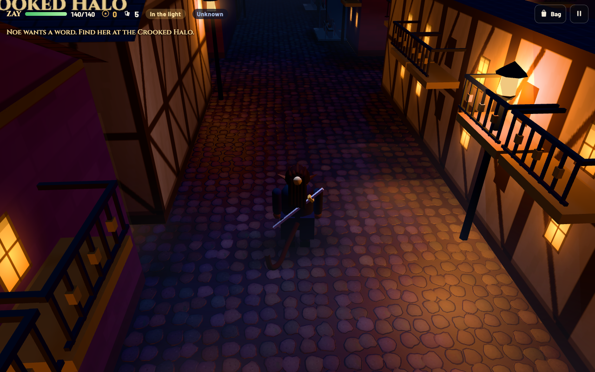
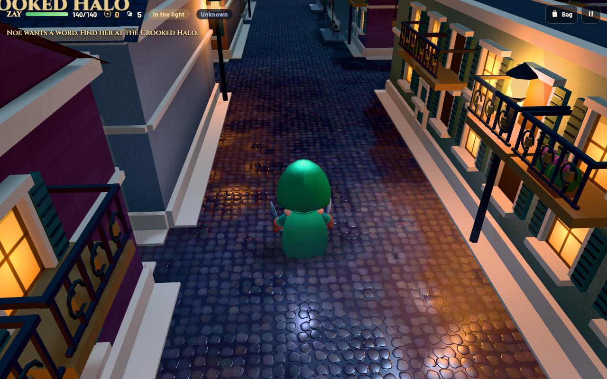
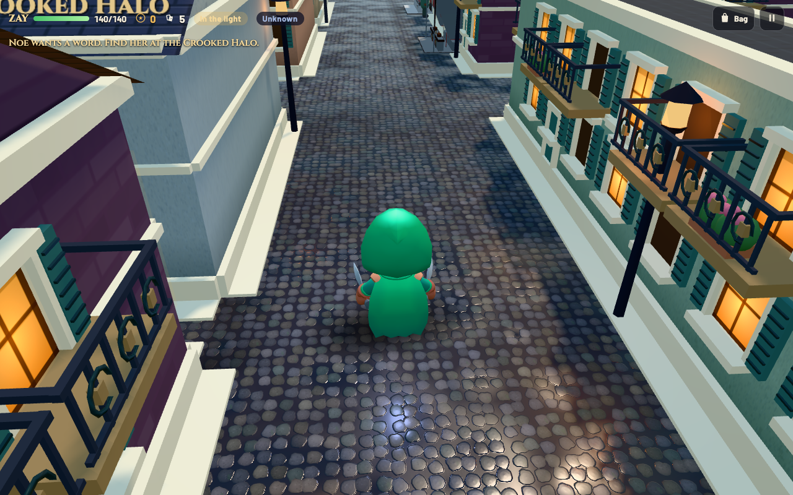
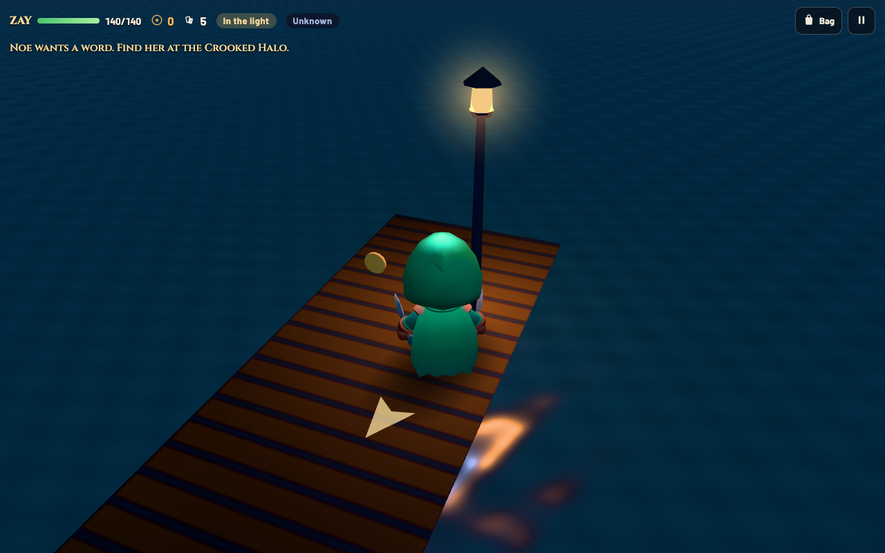

# City graphics and temporary ZAY rig

## Continuation and scope

Continues the merged third-person work at `a816738` on `feat/ledger-quest-dialogue` (PR #19). PR #18 still targets `main`; this branch targets its current development head to preserve the interactive ledger quest. Three.js r169 and its existing glTF loader remain vendored. There is no build step or added runtime dependency.

The previous scene relied on small repeating windows, broad flat wall colours, procedural people and a dark uniform background. The new work adds architectural layers, material response and an authored animated player. It is a stylized visual-development pass, not a claim of modern AAA asset fidelity.

## Implemented graphics

- Creole-inspired muted plaster colours, mottled plaster/bump maps, pale cornices/string courses/base courses and narrow sidewalk margins. Existing estate masonry remains distinct.
- Larger framed windows, paired louvered shutters, scrollwork iron galleries, recessed shop panels, flower boxes and layered hedge foliage. Existing CC0 market booths, stools, kegs and furniture are retained.
- Physically based plaster, brick, stone, roof and prop materials. Smaller-scale cobbles use gentler normal relief and a repeating wetness/roughness texture. Wet surfaces reflect a generated sky environment; they do **not** reflect arbitrary nearby buildings or characters.
- Three lighting presets: readable blue night with warm lanterns, warm dusk, and daylight. Original generated skies include cloud layers and a night moon/stars. PMREM environment lighting, fog, exposure, hemisphere/directional light and lamp intensity change together. Indoor light stays warm.
- Lit animated river ripples and an extended water surface beyond the southern river edge remove the exposed map boundary. Water remains non-navigable under the existing map rules.
- Low quality caps pixel ratio at 1, uses three local lantern lights, disables directional shadows and mist, and shortens decorative draw distance. High caps pixel ratio at 1.5, uses six local lamps and retains the existing static directional shadows. Decorative instancing uses 8×8-tile chunks and bounding spheres so distance/frustum culling can reject distant details.

Day/dusk are **visual previews**, not a new time-of-day simulation. Guard visibility, stealth and all other rules still use the existing night gameplay. Neither the maps nor save format changed. Existing shadows are static building shadows plus moving character contact shadows; this pass does not add skeletal shadow maps, screen-space reflections or global illumination.

## Temporary playable ZAY

The user approved a temporary rogue even though its appearance differs from ZAY's established design. The chosen **KayKit Adventurers 1.0 hooded rogue** has a coherent fantasy outfit, cape, dual knives, a small embedded texture atlas, a skeleton and 76 embedded clips in one 3.43 MiB GLB. It replaces the playable field model. The title, gameplay object, dialogue, portraits, saves, tail-vault ability and story still identify him as ZAY.

`hero3d.js` owns the visual configuration and `AnimationMixer`. Movement/camera/collisions remain in the existing systems. Locomotion selects idle/walk/run from actual traveled speed, changes playback speed to follow travel, and crossfades over 0.16 seconds. Dodge, card throw and silent takedown trigger one-shot clips with configurable durations; repeated actions restart correctly. Horizontal root motion is removed from cloned tracks, retaining vertical footwork. A failed model load retains the procedural player without blocking startup.

The rig is loaded once and reused across district changes. Camera occlusion, invisibility flashes, hedge transparency, the carried ledger and contact shadow still work. Battles remain the existing 2D ATB presentation.

### Asset evaluation and license

Only the KayKit model was incorporated. The other named sources were researched as alternatives:

| Source | Evaluation |
| --- | --- |
| [KayKit official creator repository](https://github.com/KayKit-Game-Assets/KayKit-Character-Pack-Adventures-1.0) | Selected: authored hooded fantasy rogue, embedded locomotion/combat clips, ready-to-load GLB, explicit CC0 license including commercial use. No account or retargeting required. |
| [Quaternius RPG Characters](https://quaternius.com/packs/rpgcharacters.html) | CC0 animated fantasy characters with glTF options. Viable alternative; the selected KayKit rogue supplied a directly usable hooded silhouette and a larger embedded action set. |
| [Quaternius Universal Base Characters](https://quaternius.com/packs/universalbasecharacters) | Useful future character base, with more outfit/hair selection and animation assembly required for this role. No files incorporated. |
| [Kenney Animated Characters](https://kenney.nl/assets/animated-characters-protagonists) | CC0 and game-ready, but the listed protagonists favour modern/science-fiction roles over this city's fantasy atmosphere. |
| [Mixamo / Adobe FAQ](https://helpx.adobe.com/creative-cloud/faq/mixamo-faq.html) | Free Adobe-ID character/animation workflow, with game use permitted. Standalone asset redistribution terms were not established for this repository workflow; no Mixamo content downloaded or included. |
| [Sketchfab](https://sketchfab.com/) | Per-model download and license verification would be required. The license page was inaccessible during research, so no candidate was accepted or incorporated. |
| [Poly Haven license](https://polyhaven.com/license) | CC0 HDRIs, textures and models are useful environmental resources; not a ready rigged rogue source. This pass generates its own environments/textures instead. |

`THIRD_PARTY_NOTICES.md` records the exact source commit, original path, SHA-256 and changes applied at runtime. `models/zay/LICENSE.txt` preserves the creator's license notice. Attribution is not mandatory under CC0, but Kay Lousberg is credited. No ripped game assets or commercial-game characters were used.

### Replacing the temporary model

1. Export the custom ZAY as a self-contained glTF 2.0 GLB with a skinned mesh, embedded materials/textures and animation clips. Keep it Y-up, feet near the ground and facing +Z, or compensate with `rotationY`. Supply idle, in-place walk and run; dodge, throw and melee clips are optional. Prefer a single atlas, few materials and a web-friendly texture/triangle budget.
2. Put the file under `models/zay/`, then update `HERO.url`. `height` normalizes the visible skinned body to game units (one tile is one unit); `rotationY` aligns it with the game's +X facing. `hide` lists optional equipment objects to hide before measuring.
3. Map semantic roles in `HERO.clips` to the custom file's exact clip names. Required roles are `idle`, `walk` and `run`. The other mappings can be removed if the file lacks those actions. `interact` is prepared but not automatically triggered by dialogue.
4. Set `rootMotionNodes` to the imported animation node names whose horizontal motion must be stripped. Three.js sanitizes punctuation in node names. Prefer in-place exported actions. Adjust `fade` and `durations` for the new actions; these settings affect the picture only, never combat timing or movement distance.
5. Add the file's provenance/license, and retest walking, sprinting, blocked movement, action transitions, all districts, camera clearance and saves. Remove the temporary KayKit asset/notice only when it is no longer distributed.

The final ZAY art brief remains: dark brown skin, pointed elven ears, hazel-gold eyes, tied loc ponytail, lean athletic build and long prehensile monkey-like tail. Supply rigged coat/hair/tail bones and appropriate secondary animation if those should move. A future continuous tail-vault animation requires separate presentation work; the existing discrete vault endpoint is preserved. Named NPCs need their own approved authored models instead of reuse of this temporary rogue.

## Verification and limits

- `npm test`: 9/9 movement and camera math checks passed.
- `npm run check`: JavaScript syntax, all four map structures and configuration JSON passed. No build step exists.
- Browser regression suite: 18 checks covering real WASD/card inputs, skeletal deformation, crossfade weights, idle/walk/run/dodge/action recovery, in-place root motion, repeated actions, collisions, camera clearance, repeated district travel/resource lifetime, lighting/quality controls and persistence, bounded environment cache, pause/inventory, simulated controller Start, Noe dialogue, save/continue, battle attack/return, vault, Classic, touch layout, WebGL fallback and deliberate character-file failure. No unexpected runtime/shader errors or missing local assets.
- Corrected validation diagnostics during development: Three's sanitized bone name is `upperlegl`, and quality diagnostics must report the renderer's applied state rather than the setting before its next frame.

Browser fixtures exercise real controls plus deterministic placements; they are not a complete campaign playthrough. Physical controllers, Safari and real mobile GPUs remain unverified. Touch layout was checked through Chrome emulation.

Local Chrome 157 on Apple M1, 1280×800, same opening position/camera, 100 animation frames per case (99 intervals), paused game state with rendering active:

| Metric | Merged baseline | High | Low |
| --- | ---: | ---: | ---: |
| Draw calls | 133 | 171 | 131 |
| Submitted triangles | 58,562 | 119,865 | 81,925 |
| Median frame interval | 16.7 ms | 16.7 ms | 16.7 ms |
| 95th percentile interval | 16.7 ms | 16.7 ms | 16.7 ms |

High increases draw calls by 29% and approximately doubles submitted geometry. This is a visible detail/rig/material tradeoff, **not a measured speedup**. Splitting decorations into cullable chunks reduced the first implementation's submitted triangles from 223,497 to 119,865, at the cost of additional draw calls. The display-capped frame result does not establish performance on phones or during busy gameplay. First-load shader/PMREM generation and district rebuilds are outside this steady-state sample. Low's raw texture count includes all three cached presets visited earlier in that run; it is not comparable to a fresh High session's count. Repeated preset visits were separately checked for stable texture counts.

Raw values: [render-comparison.json](major-overhaul/render-comparison.json). Baseline tree `29bad3b` is identical to the merged `a816738` tree.

## Captured game views

Unretouched local browser captures, inspected after rendering. Night comparisons use the same position and camera.

| Before | After |
| --- | --- |
|  |  |

## Review workflow

Branch: `feat/major-graphics-overhaul`, based on `feat/ledger-quest-dialogue`. The exact branch is excluded from automatic Git deployments in `vercel.json`. No manual deployment, merge, public alias, preview share link or protection-setting change is authorized by this work.

The private Studio Deploy Check redirected to sign-in after the reported PR #19 merge. Live deployment status could not be verified. PR #19 merged into the development branch, while PR #18 remains open against `main`; this graphics PR continues that chain.

Remaining art work: canonical ZAY, authored named NPCs/guards, richer interiors, doors/signage, non-repeating landmark architecture and distant scenery. These are the next major visual gains; the present pass retains procedural building shells and NPC bodies, and a 2D battle screen.
