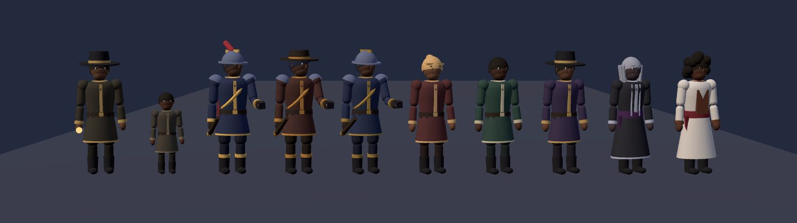
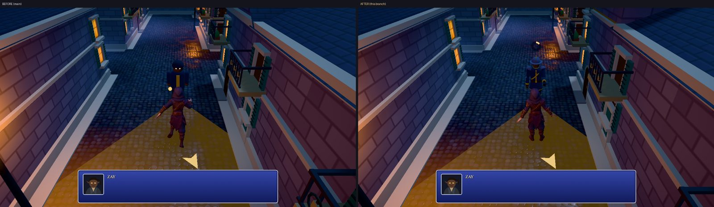
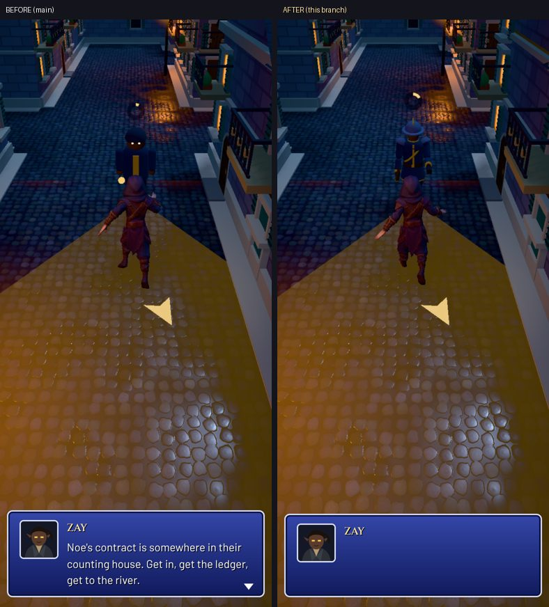
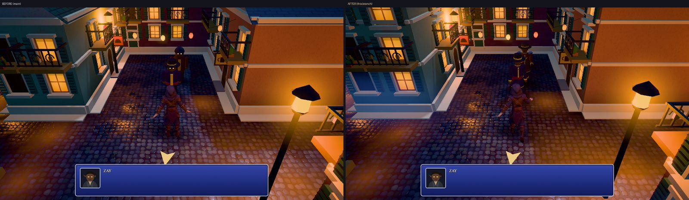
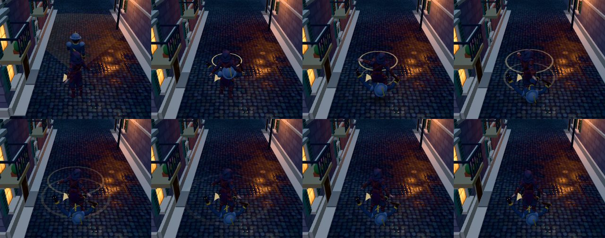
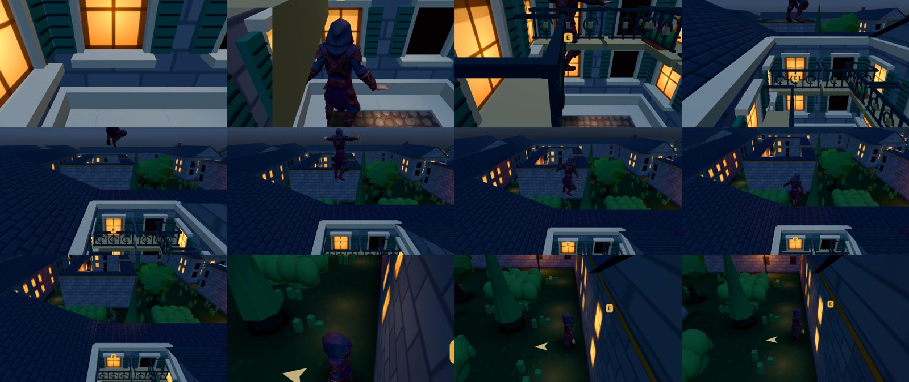
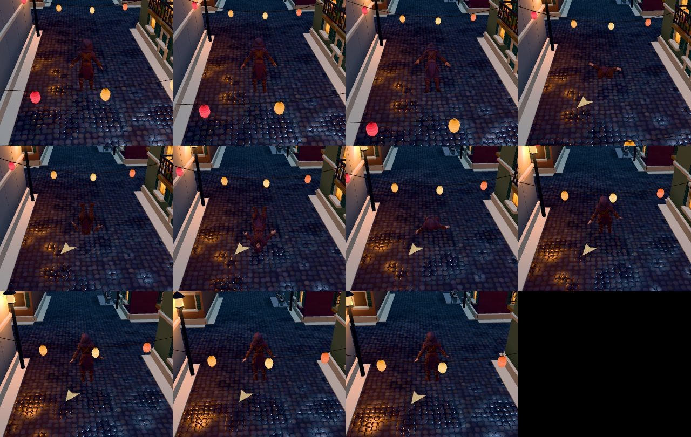
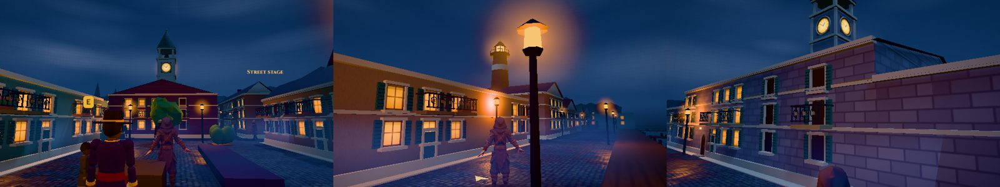
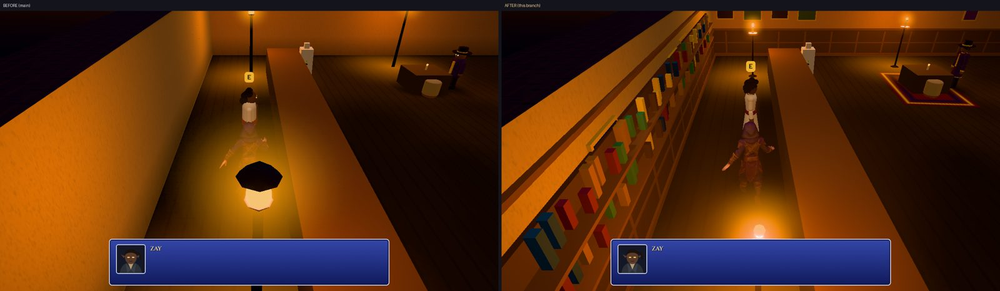
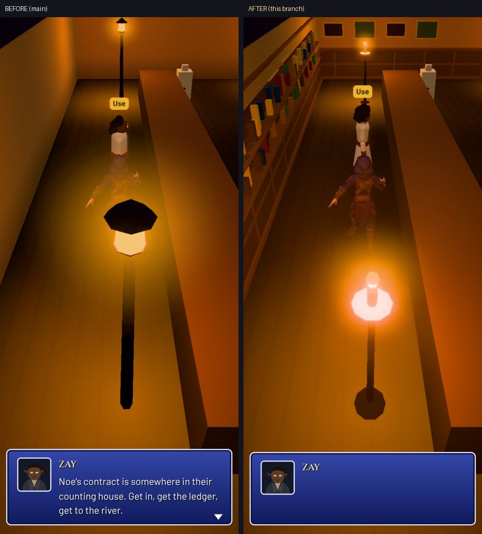

# People, movement and skyline pass

What this pass changed, with pictures. Left is `main` before the change, right is this branch, taken at the same spots with the same camera (High quality, software-rendered Chromium, 1280x720 and a 390x844 phone).

## People

Guards, the city watch, Noe, Severin, regulars, passers-by, the Soot kid and the fence are now jointed figures built in code (`people3d.js`): one skinned mesh and one draw call each, coloured from the same looks as before.

A knocked-out guard now topples instead of snapping flat:

## Movement

The tail-vault (frames 0.08 s apart) and the roll (0.04 s apart):

ZAY's walk clip covers about 35 px a second and his run clip about 90, measured from the feet in each clip; the game moves him at 118 (185 sprinting). Normal movement now plays the run clip at an easy pace and the walk clip is kept for slow movement, which removes most of the foot sliding. Sprinting still slides a little (the clip would have to play at double speed to match).

## Skyline and landmarks

Taller houses, a landmark per outdoor district and a far skyline. Seen with the camera dragged down (it can now tilt lower and looks up as it does):

## The Crooked Halo

## Numbers (High, Lantern Quarter start, 1280x720)

| | Before | After |
|---|---|---|
| Draw calls | 257 | 255 |
| Triangles | 240,000 | 322,000 |

Draw calls stayed level because each person went from about ten draws to one; the extra triangles are the rounder people, the upper storeys and the skyline.

## Not verified

Real phones, Safari, real GPUs and frame rate (all pictures and tests here ran on software rendering), and how the roll, vault and battle timing feel at real speed.
